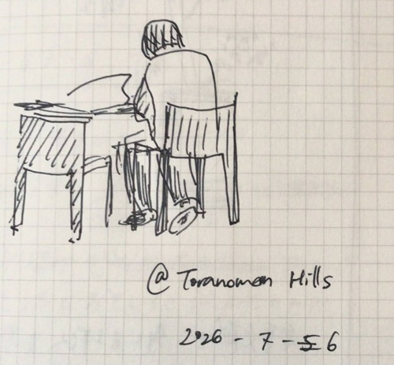
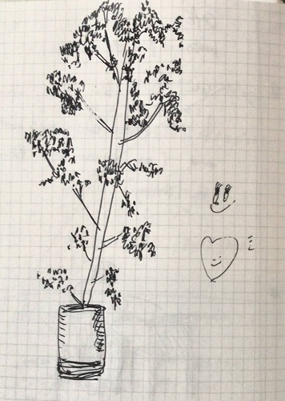
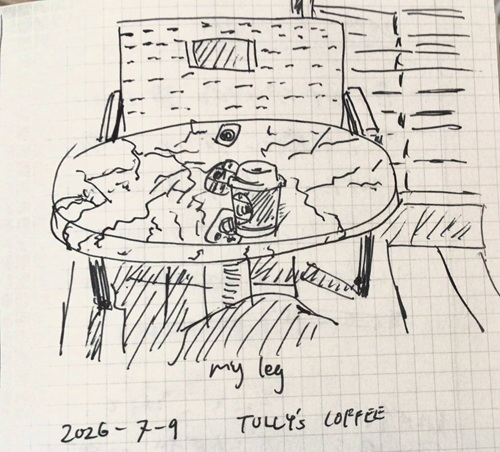
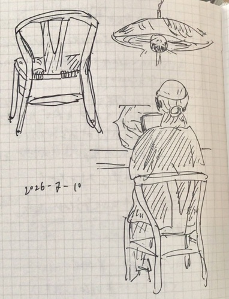
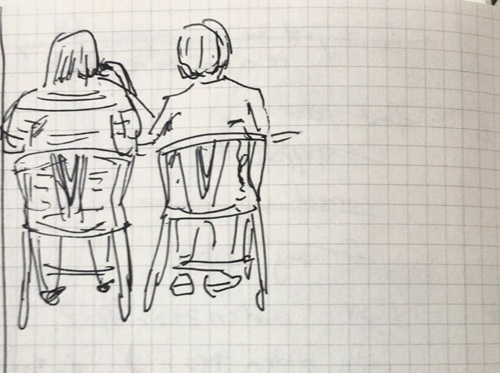
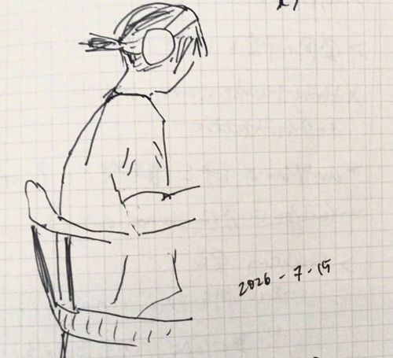

*Read the English version [here](/posts/drawing/2026-08-03_sketches/).*

## July 6

## July 9 (TULLY's COFFEE)

## July 10 (カフェ)

## July 15 (カフェ)

## 関連
- 使ったもの：[コクヨ測量野帳](/ja/posts/stationery/2026-09-07_sokuryo_yacho/)
- [スケッチ (2026.06.24 - 06.26)](/ja/posts/drawing/2026-08-03_sketches/)