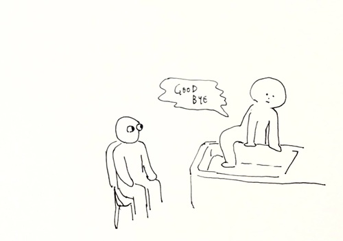

*Read the English version [here](/posts/personal/2026-10-22_my_funeral/).*

時々、自分が死んだらどんな葬式をやってほしいか考えることがある。  
特に誰かのお葬式に参列したとき、お葬式の案内を見かけたとき、そして死に関係する本を読むとき。

いつも思うのは、私のために(？)一つの空間に集まってもらって、そのままじっとしておいてもらうのは嫌だな、ということ（そもそも葬式が開かれるのか、開かれても誰か来てくれるのかわからないけれど）。  
だってじっとしていないといけない時間ってしんどくない？  
それに世の中には私の葬式に出るよりも有意義なことがいっぱいあると思うのですよ！  
死んでる私が棺から起き上がって最後の挨拶ができるわけでもないしさ...

私の死は特に悲しむようなことではないと思っている。  
他の人の人生において私という存在は、ただ「通りすがりの人」だという感覚があるから。  
だからわざわざ葬式を開くまでもないんじゃないか？とさえ思うときもある。

でももし私の葬式があるのだとしたら、できるだけ規模の小さいものだといいな、と...  
でも私が死んだ後なら私の周りの人がしたいような葬式にしてもらうのが一番かも？
