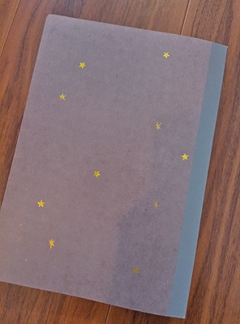
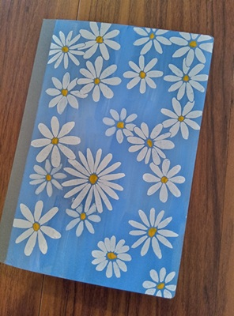
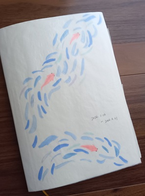
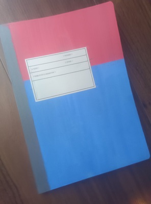

*[日本語で読む](/ja/posts/crafting/2026-06-06_decorating_notebook_covers/)*  
*note: I once wrote this post using AI, but I rewrote it completely by myself.*

Last year I started decorating notebook covers.  
This is the first notebook I decorated, I used stickers and pens to make it look like night sky.

Then I began to paint flowers,

  

and fish.

  

I also made simple one too.

These notebooks feel more like "mine" than the ones I haven't decorated, I never knew I would feel more attached to them!
