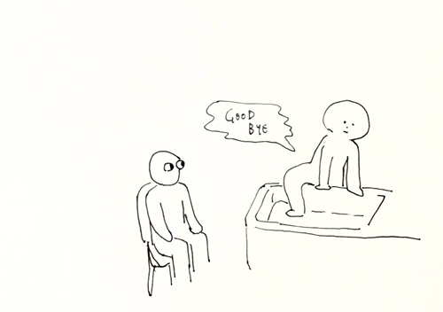

Sometimes, I think about how I want my funeral to be like.  
I think about it when I attend or see someone's funeral, or when I read books on death.

One thing that always comes to my mind is that I don't want to keep people stuck in one place FOR  ME (I don't know if there will be any guests at funeral or whether there will be a funeral in the first place).  
Aren't there so many better things to do instead?   
It's not like I can get up from a coffin and say goodbye...  

I don't think my death will be something to be sad about, I will just be "someone who passed by".

But if there will be my funeral, I want it to be as small as possible.