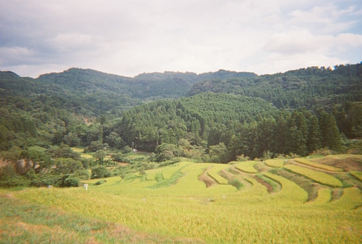
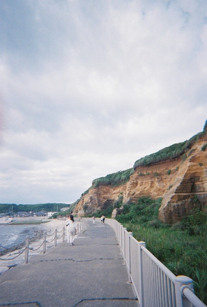
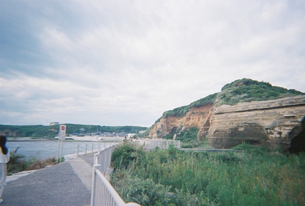
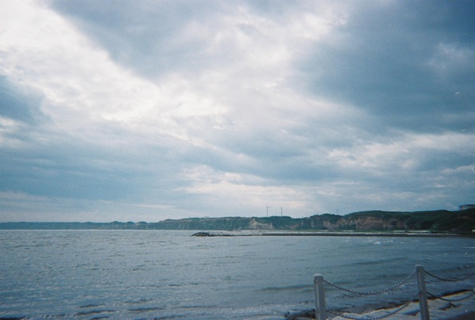
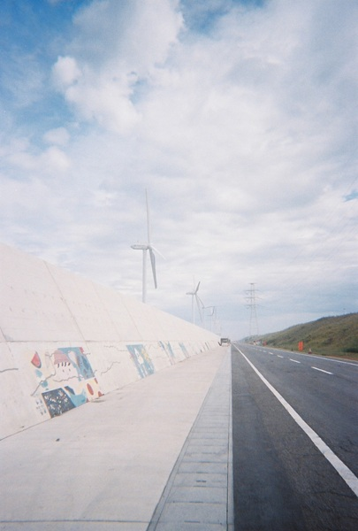
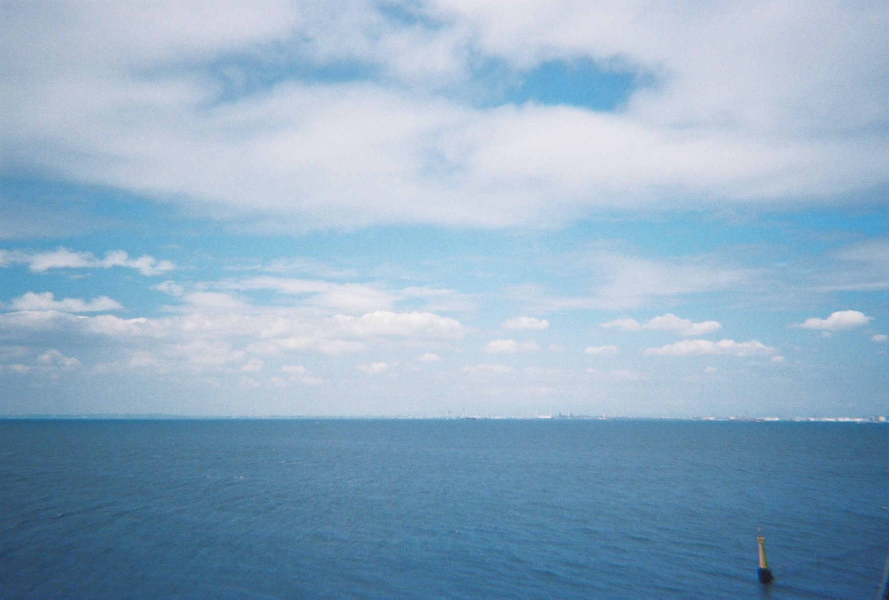

Photos I took with [my Kodak Film Camera M38](/posts/lifelog/2026-08-27_film_camera/) when I went on a short trip to Chiba and Ibaraki.

Oyama Senmaida in Chiba.

Byoubugaura Cliffs (Chiba).

Sennin Garo in Ibaraki.

And the ocean (I don't remember where I took it...)

## Links
- Byoubugaura Cliffs:
    - <a class="icon-new-tab" target="_blank" href="https://www.ana.co.jp/en/us/japan-travel-planner/chiba/0000002.html">Byoubugaura Cliffs, nicknamed the Dover of the Orient and a famous filming location in Choshi, Chiba</a>Japan Travel Planner - ANA (last accessed: 2026-11-06)
    - <a class="icon-new-tab" target="_blank" href="https://www.choshikanko.com/kankoDB/%E5%B1%8F%E9%A2%A8%E3%82%B1%E6%B5%A6/">屏風ケ浦 | 銚子市観光協会</a> (last accessed: 2026-11-06)
    - <a class="icon-new-tab" target="_blank" href="https://online.bunka.go.jp/heritages/detail/284776">屏風ケ浦 文化遺産オンライン</a> (last accessed: 2026-11-06)
- Oyama Senmaida:
    - <a class="icon-new-tab" target="_blank" href="https://www.visitchiba.jp/things/oyama-senmaida/">Oyama Senmaida | Terraced Rice Paddies Near Tokyo</a> Visit Chiba (last accessed: 2026-11-06)
    - <a class="icon-new-tab" target="_blank" href="https://maruchiba.jp/spot/detail_10374.html">大山千枚田｜スポット・体験｜千葉県公式観光サイト ちば観光ナビ</a> (last accessed: 2026-11-06)
    - <a class="icon-new-tab" target="_blank" href="https://www.city.kamogawa.lg.jp/site/kamogawa-kanko/816.html">日本の棚田百選・棚田遺産「大山千枚田」 - 鴨川市公式ホームページ</a> (last accessed: 2026-11-06)
- Senin Garo:
    - <a class="icon-new-tab" target="_blank" href="https://www.kamisu-kanko.jp/kankou-page/1000ningarou.html">1000人画廊｜神栖市観光協会</a> (last accessed: 2026-11-06)
 
## Related
- [My Favorite Belonging: KODAK Film Camera M38](/posts/lifelog/2026-08-27_film_camera/)