I enjoyed sharing photos on Instagram especially around 2012 to 2015.  
I had a lot of fun using filters to make them look aesthetic, and surfing around accounts via tags I used.

Here are the photos from those days...  
(I can't believe they are over 10 years old now)

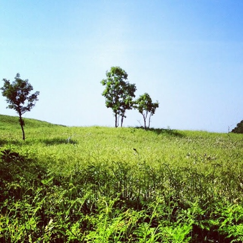

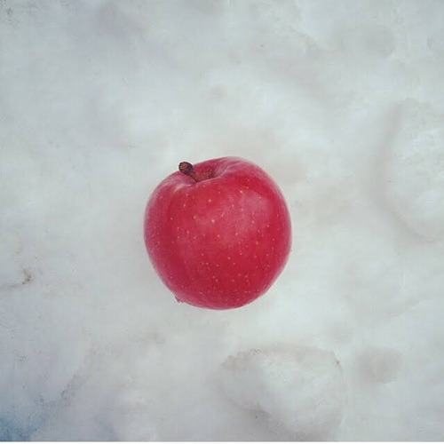

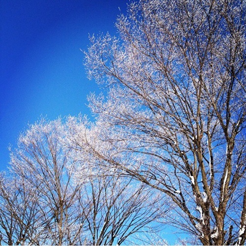

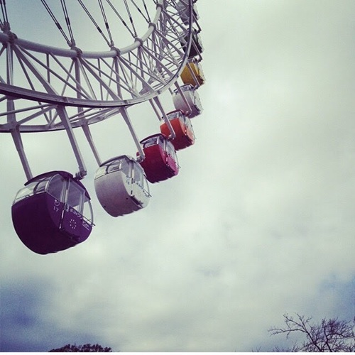

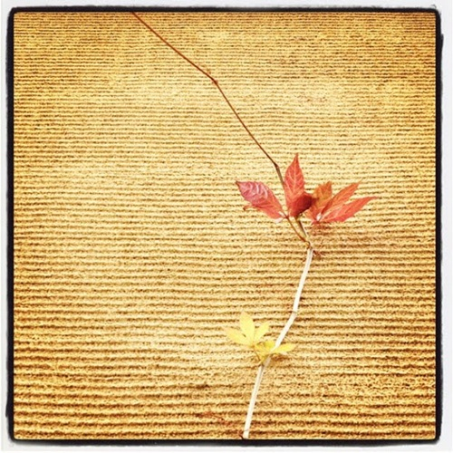

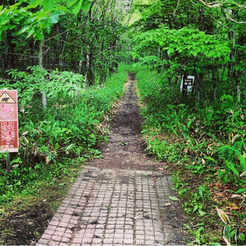

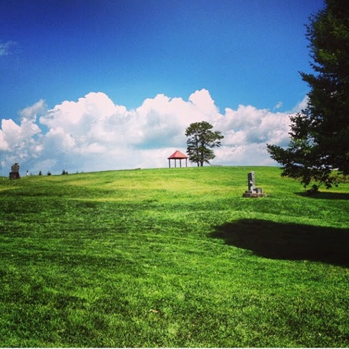

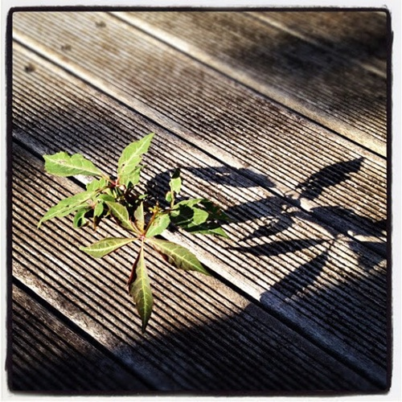

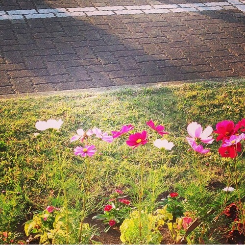

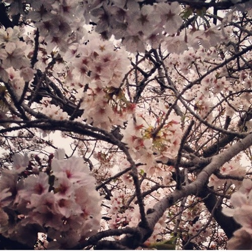

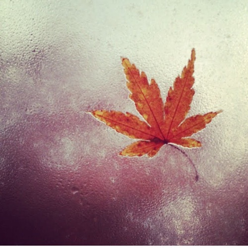

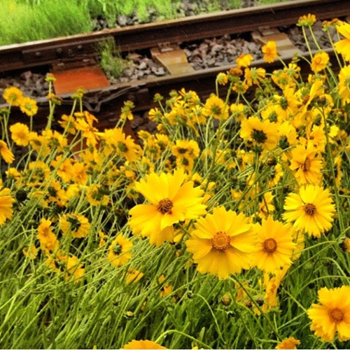

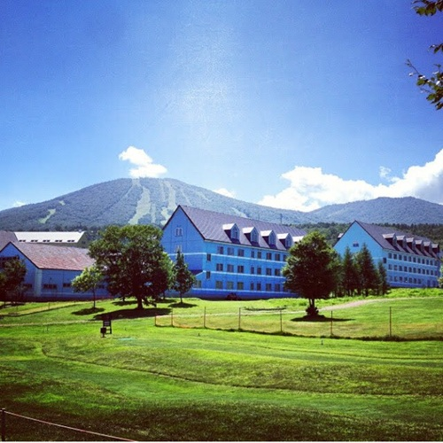

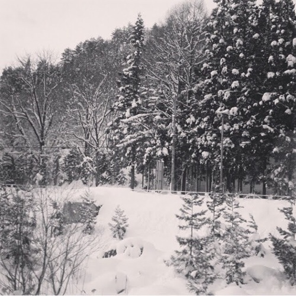

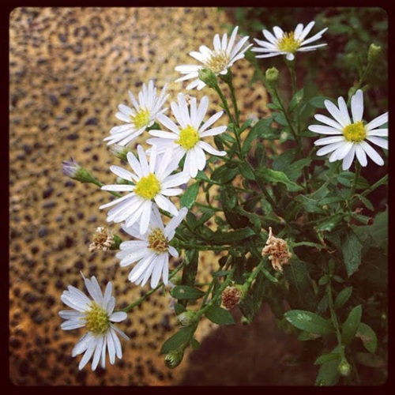

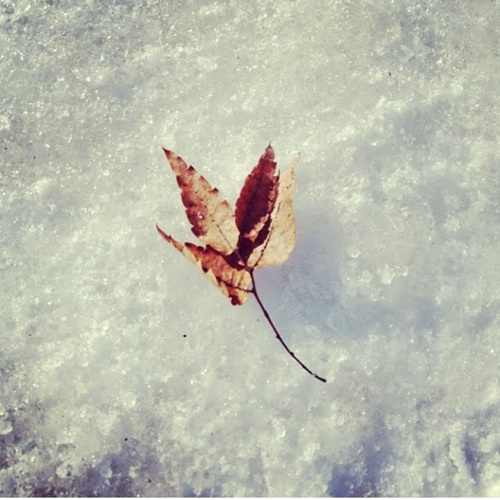

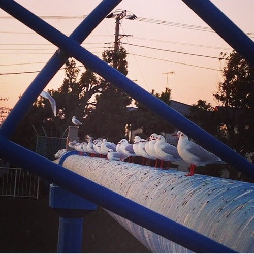

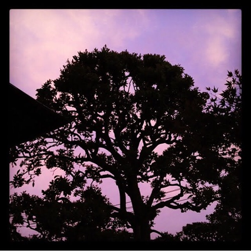

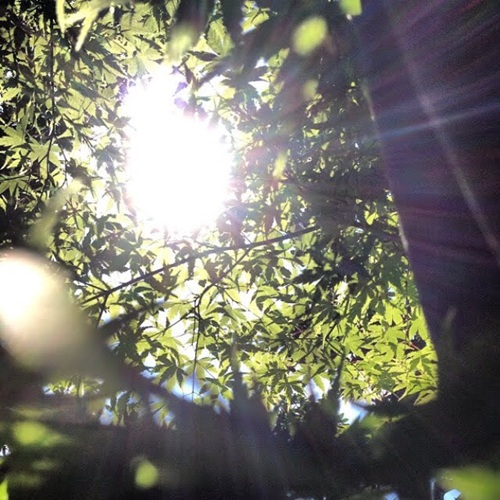

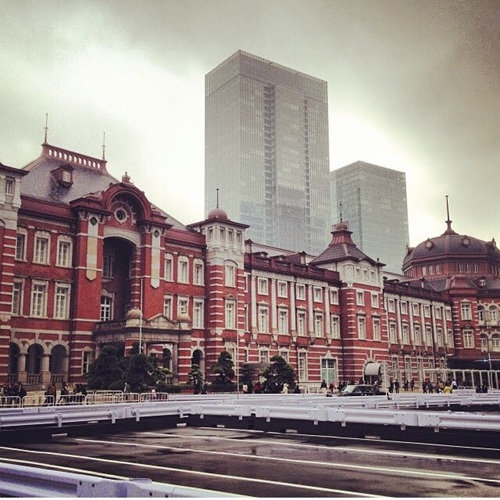
