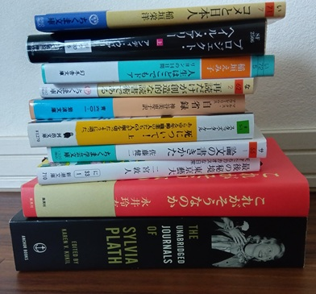

*note: I once wrote this post using AI, but I rewrote it completely by myself.*

Visiting a bookstore is one of my favorite things to do, but there's a problem: I buy way more books than I can read.

I like buying books in a bookstore, because I can flip through books before deciding to buy them.  
You can do that with ebooks I suppose, but there are books you can find, only by visiting bookstores and reading staff's recommendations.

When I encounter interesting books, I think to myself "I don't know if I can find this book again!"  
So I often end up buying at least a few books every time I go to a bookstore.  
And I visit different bookstores a few times a week.  

No wonder now I have a stack of books I haven't read yet.

I need to keep myself from buying more books for a while...seriously. 

## Related

As of September 2026, I buy less books now:
- [I buy less books lately](/posts/reading/2026-09-19_I_buy_less_books/)